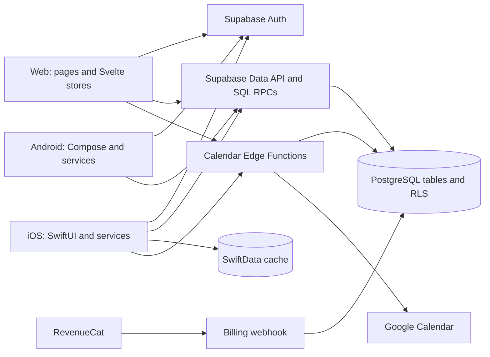

# Meeting Scheduler architecture and code review

Review date: October 21, 2026

Repository baseline: `e69220000deb736481d506809a6b52de1ff85eb3`

Scope: SvelteKit web app, SwiftUI iOS app and shared Swift package, native Kotlin/Compose Android app, Supabase migrations and Edge Functions, billing, calendars, persistence, and build automation.

The original report branch started from `main` at `d9d1284`. The findings and original validation results describe the reviewed baseline above, including its unmerged SwiftData work. Source paths and line numbers in those findings refer to that snapshot. The [implementation sequence](#proposed-implementation-sequence) was updated on October 22 against `962e2bd`, after merging `main` at `457eeeb`, and records the remaining work and opportunities for parallel delivery.

## Assessment

The basic platform choice is reasonable for this product. Supabase provides a common relational database, authentication, and managed APIs; the clients can remain native to their platforms. The database already has useful foreign keys, indexes, and some constraints. iOS has service protocols, preview mocks, persistence abstractions, batched list queries, and a nested detail query. These are useful foundations.

The main weakness is where the system makes authoritative decisions. Clients write directly to database tables, while ownership, invitation access, subscription limits, poll state, and multi-step changes are only partly enforced by the backend. Some later security migrations widen access. Client checks cannot compensate for those policies because callers can use the same public API without the UI.

**At the reviewed baseline, the highest-priority finding was that Google Calendar credentials were stored in publicly readable profile rows.** The calendar remediation is now merged; its rollout evidence is tracked in the implementation sequence below. Other high-priority findings allow access to another user's polls through privileged functions, forged poll membership, changes to anonymous participant records, and changes to responses after a poll closes. These findings follow from the checked-in migrations; the deployed database was not inspected.

Scalability problems are mostly avoidable amplification: two extra queries per poll on web and Android, a Google API request per proposed time, and a web subscription to response changes across all readable polls. There is also no consistent pagination contract. These problems will increase latency and cost before there is evidence that the database needs a more complex topology.

Maintainability suffers from three separate implementations of business rules, incomplete Android integrations, weak release checks, and an iOS app wrapper recorded as a submodule without its submodule mapping. iOS persistence is a useful addition, but its invalidation, deletion reconciliation, and account lifecycle are incomplete.

**Recommendation:** keep the current platforms and Supabase. Introduce a small set of server-owned commands and queries, with explicit authorization, transactions, bounded results, and versioned contracts. Give each client a repository/service adapter and an account-scoped state lifecycle. The findings below describe the work in actionable units.

## What was verified

This is a source review with local builds and offline reproductions. Findings marked **Confirmed in source** identify behavior or missing enforcement visible in this checkout. **Reproduced locally** means the relevant behavior was also demonstrated with synthetic data. **Deployment-dependent** means the code contains a weakness whose reachability depends on configuration outside the repository.

Database findings assume the migrations are applied in order with standard Supabase API grants. Live grants, policies, Edge Function gateway settings, provider dashboards, backups, network controls, and production telemetry were not inspected. No production user data or credentials were queried. No load test or native UI test was completed, so this report does not assign a supported user count or request rate.

| Check | Result | What it establishes |
| --- | --- | --- |
| Web production build: `npm run build` | Passed | The current web bundle builds. Adapter-auto reported that it could not identify a production hosting environment. |
| Web type/accessibility check: `npm run check -- --output machine` | Failed: 17 errors, 7 warnings in 4 files | The release build does not enforce the separate type check. Errors include the participant-count assignment, nullable poll access, and an image event type. |
| Offline review reproductions | 9 behaviors reproduced | Web store failure; daylight-saving date errors; calendar handler trust, error, and request-count behavior; webhook ordering, unknown-event, and acknowledgement behavior. |
| iOS simulator build, signing disabled | Failed inside RevenueCat | Under the installed Xcode 27.1 toolchain, RevenueCat's `PaywallColor.swift:57` reports an invalid redeclaration of `init(stringRepresentation:)`. Application compilation and tests were not established. |
| Android: `./gradlew --offline --no-daemon :app:testDebugUnitTest` | Stopped during Gradle setup | The installed Java 26.0.1 / Gradle 8.11.1 combination failed before application compilation. This is a validation limitation, not evidence of an Android source compile error. |
| iOS source checkout | Broken submodule mapping confirmed | Git records `apps/mobile/MeetingScheduler` as mode `160000`; there is no `.gitmodules` mapping. `git submodule status` fails. |
| Dependency advisory scan | Not run | Automatic approval review blocked sending the dependency inventory to npm; the user chose to finish without that scan. No conclusion about current package CVEs is made. |

The [offline reproduction script](architecture-review-evidence-2026-10-21/reproduce.mjs) uses the checked-in Edge Function handlers with mocked Supabase and Google services. Its [recorded output](architecture-review-evidence-2026-10-21/reproduction-results.txt) distinguishes handler behavior from deployed gateway protection. It deliberately asserts the observed defects; it is not a passing application test suite. See also the [web check output](architecture-review-evidence-2026-10-21/web-check.txt). To rerun the reproductions from the repository root with the installed web dependencies:

```bash
node --disable-warning=ExperimentalWarning docs/architecture-review-evidence-2026-10-21/reproduce.mjs
```

## Architecture as implemented

| Area | Current structure | Architectural consequence |
| --- | --- | --- |
| Web | SvelteKit pages, module-level Svelte stores, Supabase and RevenueCat browser clients | Most orchestration runs in pages/stores. Database policies provide the main authorization boundary. |
| iOS | SwiftUI app wrapper, `MeetingSchedulerApp` views, `Shared` models/services, SwiftData cache | Views can use protocol-backed services, but production services still reach global singletons and separately create persistence providers. |
| Android | Standalone Gradle app with Kotlin/Compose and hand-maintained services | The current code is a separate native implementation. The root README's description of Android being transpiled through Skip is stale. |
| Backend | PostgreSQL tables, RLS policies, SQL RPCs, three Edge Functions | Authorization is split between policies, privileged functions, and clients. Business operations do not share one transactional boundary. |
| Integrations | RevenueCat webhook; Google OAuth tokens and calendar checks; local device calendars | Billing and calendar results need explicit failure, identity, and retry contracts. |



## Reading the findings

There are **27 findings: 1 Critical, 12 High, 13 Medium, and 1 Low**. Severity reflects user impact and exposure: **Critical** requires immediate containment if deployed; **High** threatens privacy, authorization, billing integrity, or a central user workflow; **Medium** creates operational, scaling, correctness, or maintenance problems that should be scheduled; **Low** is hardening or cleanup with limited demonstrated impact.

Complexity is a rough estimate for one engineer familiar with the project, including focused regression checks: **Small** is up to 2 engineer-days; **Medium** is 3–5 days; **Large** is 1–2 engineer-weeks. Estimates exclude provider review, app-store approval, and rollout waiting time. Related findings share work, so their estimates should not be added as a project quotation.

| ID | Severity | Finding | Platform / area | Complexity |
| --- | --- | --- | --- | --- |
| [F01](#f01-calendar-credentials-are-publicly-readable) | Critical | Calendar credentials are publicly readable | Backend; all clients / Security | Large; immediate containment Small |
| [F02](#f02-privileged-database-functions-do-not-authorize-the-caller) | High | Privileged RPCs accept another user's identity | Backend; all clients / Security | Medium |
| [F03](#f03-participant-policies-expose-data-and-allow-anonymous-record-takeover) | High | Participant rows are globally readable and anonymous rows editable | Backend; all clients / Security | Medium |
| [F04](#f04-poll-membership-can-be-forged-or-duplicated) | High | Membership does not bind identity to the caller | Backend; all clients / Security, maintenance | Medium |
| [F05](#f05-paid-limits-and-event-pass-redemption-are-not-enforced) | High | Paid limits and passes lack authoritative enforcement | Backend; all clients / Security, scale | Large |
| [F06](#f06-response-writes-do-not-enforce-poll-boundaries-or-closed-state) | High | Responses can cross poll boundaries or change after closing | Backend; all clients / Security, maintenance | Medium |
| [F07](#f07-calendar-functions-decode-identity-without-verifying-it) | High, deployment-dependent | Calendar handlers trust unverified identity | Edge Functions / Security | Medium |
| [F08](#f08-billing-webhooks-can-lose-purchases-or-regress-subscription-state) | High | Webhook state is vulnerable to retries, ordering, and lost writes | Backend billing; all clients / Maintenance, security | Large |
| [F09](#f09-creating-a-poll-is-not-one-transaction) | Medium | Poll creation can leave a partially created active poll | All clients, backend / Maintenance | Medium |
| [F10](#f10-saving-availability-can-report-success-after-failed-writes) | High | Save UI can diverge from persisted availability | iOS; web and Android related / Maintenance | Medium |
| [F11](#f11-ios-cache-freshness-and-reconciliation-are-incomplete) | Medium | Cached detail can be stale or resurrect deleted data | iOS / Maintenance, scale | Large |
| [F12](#f12-account-changes-do-not-reset-all-state-and-caches) | High | Account changes can retain another account's state | All clients; strongest iOS evidence / Security, maintenance | Large |
| [F13](#f13-android-singletons-retain-an-activity-and-its-cancelled-scope) | Medium | Singleton lifetimes conflict with Activity lifetimes | Android / Maintenance | Medium |
| [F14](#f14-android-authentication-callbacks-are-not-connected) | Medium | Magic-link and browser OAuth callbacks are incomplete | Android / Maintenance | Medium |
| [F15](#f15-android-google-calendar-is-an-unfinished-adapter) | Medium | Google Calendar uses stubs and the wrong token type | Android, backend / Maintenance, security | Large |
| [F16](#f16-calendar-results-confuse-unknown-with-no-conflict) | High | Failed or incomplete checks appear conflict-free | All clients, backend / Maintenance | Medium |
| [F17](#f17-calendar-requests-have-unbounded-work-and-provider-fan-out) | Medium | Calendar work grows directly with caller-supplied slots | Backend, web, iOS / Scale, security | Medium |
| [F18](#f18-poll-lists-make-two-extra-requests-per-poll) | Medium | Lists amplify requests; web counts are incorrect | Web, Android / Scale, maintenance | Medium |
| [F19](#f19-read-apis-have-no-consistent-pagination-or-completeness-contract) | Medium | Reads grow without bounds or silently truncate | All clients, backend / Scale, maintenance | Large |
| [F20](#f20-web-realtime-subscribes-to-response-changes-across-polls) | Medium | Realtime causes unrelated refetches and misses poll changes | Web, backend / Scale, maintenance | Medium |
| [F21](#f21-date-only-values-and-instants-are-mixed) | Medium | Date ranges fail across daylight-saving changes | Web; cross-platform date contract / Maintenance | Medium |
| [F22](#f22-web-auth-state-handling-can-throw-or-deadlock) | High | Auth store subscriptions fail on later updates | Web / Maintenance | Small |
| [F23](#f23-shared-contracts-and-service-dependencies-are-only-partly-centralized) | Medium | Duplicated rules and hidden dependencies increase drift | All clients / Maintenance | Large, incremental |
| [F24](#f24-automated-release-checks-do-not-cover-the-system) | Medium | CI and tests do not protect critical behavior | All platforms, backend / Maintenance, security | Large, incremental |
| [F25](#f25-the-ios-app-wrapper-is-not-reproducible-from-a-clean-checkout) | High | iOS app source is an unmapped gitlink | iOS, repository / Maintenance | Small |
| [F26](#f26-android-release-builds-can-silently-use-debug-signing) | Medium | Release configuration falls back to debug signing | Android / Security, maintenance | Small |
| [F27](#f27-integration-diagnostics-include-authentication-headers) | Low | Diagnostic logging includes auth-header content | Backend, mobile / Security, maintenance | Small |

## Findings

### F01. Calendar credentials are publicly readable

**Severity:** Critical. **Area:** Backend, affecting web, iOS, and Android / Security. **Complexity:** Large, 1–2 weeks for migration and client changes; immediate containment is Small. **Evidence status:** Confirmed in source; production exposure unverified.

**Description.** The profile table combines public identity data with Google access and refresh tokens, while its read policy accepts every row.

**Details.** The initial migration creates a profile `SELECT` policy with `USING (true)` and no role restriction. Migration 00008 adds calendar tokens to that same table without changing access. With standard Supabase grants, a caller can select those columns for other users. Refresh tokens are long-lived credentials. The web auth callback and iOS auth service write provider tokens directly to the profile. Regular profile loads also use broad selects, which unnecessarily deliver token columns to clients.

**Proposed solution.** Immediately restrict profile reads and remove token columns from public API projections. Move provider credentials into a private schema/table accessible only to tightly scoped backend code. Encrypt stored credentials with separately controlled keys, and expose a safe calendar-connection status instead of tokens. Update all clients and plan compatibility during mobile rollout. If deployed, investigate which grants may have been exposed and revoke/replace affected provider credentials after containment.

**Alternatives.** Column-level grants plus a safe profile view can provide a smaller transitional change. A managed secret store can hold provider credentials instead of PostgreSQL.

**Code references:** [Initial schema](../supabase/migrations/00001_initial_schema.sql), lines 10–18 and 209–218; [calendar migration](../supabase/migrations/00008_add_calendar_integration.sql), lines 4–14; [web callback](../apps/web/src/routes/auth/callback/+page.svelte), lines 22–40; [iOS auth service](../apps/mobile/Sources/Shared/Services/AuthService.swift), lines 242–260.

### F02. Privileged database functions do not authorize the caller

**Severity:** High. **Area:** Backend, all clients / Security. **Complexity:** Medium, 3–5 days. **Evidence status:** Confirmed in source.

**Description.** Several `SECURITY DEFINER` functions use an identifier supplied by the caller without checking the caller's access to that user or poll.

**Details.** `get_user_participated_polls(user_uuid)` returns the supplied user's created and joined polls, including non-active polls. Its default of `auth.uid()` does not prevent a caller passing a different UUID. `get_poll_with_summary(poll_uuid)` returns a poll, participants, notes, and responses without an access check. Subscription/pass helper functions also accept arbitrary user UUIDs. These functions execute with elevated privileges, and the migrations contain no default execute revocation. Adding a grant for `authenticated` does not remove the default grant to `PUBLIC`.

**Proposed solution.** Derive user identity from the authenticated context and remove arbitrary user parameters from self-service RPCs. Use invoker privileges where appropriate. Where elevated privileges are necessary, explicitly check access, pin `search_path`, schema-qualify objects, revoke execution from unneeded roles, and keep internal helpers outside the exposed API schema. Add tests for anonymous, owner, participant, and unrelated callers.

**Alternatives.** Route these operations through authenticated Edge Functions that return explicit DTOs and authorize each object. The database still needs restricted direct RPC access.

**Code references:** [Final participated-polls function](../supabase/migrations/00005_remove_distinct_from_joined_polls.sql), lines 4–24; [initial helper functions and summary](../supabase/migrations/00001_initial_schema.sql), lines 338–475; [share-code lookup](../supabase/migrations/00002_add_poll_share_codes.sql), lines 78–101. The privilege behavior is documented in [Supabase database functions](https://supabase.com/docs/guides/database/functions#security-definer-vs-invoker).

### F03. Participant policies expose data and allow anonymous record takeover

**Severity:** High. **Area:** Backend, all clients / Security. **Complexity:** Medium, 3–5 days. **Evidence status:** Confirmed in source.

**Description.** Migration 00010 makes every participant row readable and allows any caller to update a participant whose `user_id` is null.

**Details.** The policy named "Participants can view poll participants" uses `USING (true)` without checking membership. It exposes participants in closed/private polls, anonymous email addresses, comments, and the `access_token` field. The comment-update policy accepts `user_id IS NULL` in both its old-row and new-row conditions. It governs whole-row updates, so its name does not restrict changes to the comment column. A caller can change an anonymous participant's identity fields or claim the record by assigning their own user ID. Earlier restrictive policies remain insufficient because permissive policies combine with OR. Active poll rows are also globally selectable: a share code currently provides convenient lookup, rather than a secrecy boundary.

**Proposed solution.** Replace the broad policies with explicit owner/member/invitation authorization. Return only safe participant fields. Restrict editable columns or expose a narrow update command. If anonymous participation remains supported, validate a separate unguessable capability and store its verifier securely; do not publish that capability with participant lists.

**Alternatives.** Require authentication for participation. Explicitly public polls can use a separate public projection with limited fields.

**Code references:** [Comment-security migration](../supabase/migrations/00010_add_comment_security.sql), lines 12–31; [participant schema and initial policies](../supabase/migrations/00001_initial_schema.sql), lines 159–181 and 242–308. Policy composition follows [PostgreSQL CREATE POLICY](https://www.postgresql.org/docs/17/sql-createpolicy.html).

### F04. Poll membership can be forged or duplicated

**Severity:** High. **Area:** Backend, all clients / Security, maintainability. **Complexity:** Medium, 3–5 days. **Evidence status:** Confirmed in source.

**Description.** The join policy checks that a poll is active, but does not bind the submitted user ID to the authenticated caller. The schema also allows duplicate memberships.

**Details.** Direct inserts can name another user's UUID as `user_id`. That creates a participant record attributed to someone who did not join and can make the poll appear in that person's joined list. There is no unique constraint on `(poll_id, user_id)`, despite migration 00005's comment that a user can only join once. Double taps, retries, or simultaneous devices can create duplicate participants, inflate counts, split availability, and duplicate joined polls in the RPC response.

**Proposed solution.** Implement an idempotent join command that derives `user_id` from the session, checks invitation access and poll state, and returns the existing membership on retry. Add a partial unique index on `(poll_id, user_id)` for authenticated participants after reconciling existing duplicates. Protect ownership fields from subsequent client changes.

**Alternatives.** Retain direct inserts with strict RLS checks, immutable identity fields, a uniqueness constraint, and a separate anonymous capability flow.

**Code references:** [Participant identity and join policy](../supabase/migrations/00001_initial_schema.sql), lines 159–181 and 297–308; [joined-poll assumption](../supabase/migrations/00005_remove_distinct_from_joined_polls.sql), lines 1–19; [web join](../apps/web/src/lib/stores/polls.ts), lines 290–316.

### F05. Paid limits and event-pass redemption are not enforced

**Severity:** High. **Area:** Backend and all clients / Security, scalability. **Complexity:** Large, 1–2 weeks. **Evidence status:** Confirmed in source.

**Description.** Creation limits, participant limits, premium settings, and pass consumption are not enforced at the database write boundary.

**Details.** The poll insert policy checks only the creator's identity. The `can_create_poll` RPC is an optional preflight, rather than a condition of creation. Creators can directly set `is_premium` and `max_participants`. Joining does not check capacity. The pass table records redemption fields, but the checked-in application and SQL contain no operation that atomically consumes a pass when a poll is created. One unredeemed pass can therefore continue making the preflight return true. Android separately allows three active free polls and hardcodes paid access to false; shared configuration and SQL specify one free poll.

**Proposed solution.** Centralize entitlement-derived limits in server-owned create/join commands. Check expiry, derive premium fields, enforce capacity, and redeem a pass inside the creation transaction. Serialize competing operations for the same user or poll so simultaneous requests cannot exceed limits. Put bounds on titles, notes, options, and other user-controlled payloads.

**Alternatives.** Database triggers can enforce the same invariants while retaining direct table writes. Client checks can remain as early feedback.

**Code references:** [Poll policies and quota helper](../supabase/migrations/00001_initial_schema.sql), lines 249–255 and 389–414; [pass schema](../supabase/migrations/00001_initial_schema.sql), lines 75–88; [Android limit logic](../apps/android/app/src/main/kotlin/com/meetingscheduler/android/services/PollService.kt), lines 332–340; [shared entitlement configuration](../packages/shared-config/entitlements.json).

### F06. Response writes do not enforce poll boundaries or closed state

**Severity:** High. **Area:** Backend, all clients / Security, maintainability. **Complexity:** Medium, 3–5 days. **Evidence status:** Confirmed in source.

**Description.** Response ownership is checked, but the backend does not require the time option to belong to the participant's poll or require that poll to remain open.

**Details.** A response has separate foreign keys to a participant and time option. Each referenced record must exist, but nothing requires their poll IDs to match. The response management policy checks only that the participant belongs to the caller. It does not check `status` or `closes_at`, so direct API writes can continue after closure, contrary to the web close confirmation. Final selected start/end times also have no pair/range constraint or link to a valid option.

**Proposed solution.** Have an availability command validate caller, membership, matching poll, open state, and deadline in one transaction. Enforce relational invariants with composite foreign keys or a database trigger. Add constraints for valid selected-time pairs and ranges, and authorize finalization as a state transition.

**Alternatives.** Keep direct response upserts but strengthen RLS and triggers for every invariant, including updates and deletes.

**Code references:** [Response table and management policy](../supabase/migrations/00001_initial_schema.sql), lines 188–203 and 324–332; [selected-time fields](../supabase/migrations/00001_initial_schema.sql), lines 109–124; [web closure promise](../apps/web/src/routes/polls/[id]/+page.svelte), lines 214–216.

### F07. Calendar functions decode identity without verifying it

**Severity:** High, deployment-dependent. **Area:** Calendar Edge Functions / Security. **Complexity:** Medium, 3–5 days. **Evidence status:** Reproduced locally at the handler boundary; deployed reachability unverified.

**Description.** Calendar handlers obtain identity by decoding JWT text, then use a service-role client. They do not independently verify that identity.

**Details.** Both calendar functions accept the decoded `sub`. Expiration is checked only when present; issuer and role mismatches only produce warnings. The conflict function also accepts `x-user-id` when a bearer token is absent. Its unused signature helper returns true. The repository disables gateway JWT checks only for the billing webhook, so this review does **not** establish a forged-token bypass through the deployed calendar gateway. However, if gateway checking is disabled or a handler becomes reachable elsewhere, the local reproductions show that forged claims and caller-selected IDs are accepted before privileged access to calendar credentials.

**Proposed solution.** Use supported Supabase token verification and derive identity solely from verified claims. Remove the caller-controlled identity fallback and homemade decoder. Require authenticated user claims before creating a narrowly used admin client. Make gateway requirements explicit and test unauthorized requests through the deployed/staging entry point. Supabase documents supported verification in [JWT guidance](https://supabase.com/docs/guides/auth/jwts).

**Alternatives.** A verified authentication middleware can supply a trusted context shared by both functions.

**Code references:** [Conflict handler](../supabase/functions/check-calendar-conflicts/index.ts), lines 13–103 and 269–320; [token-store handler](../supabase/functions/store-calendar-token/index.ts), lines 9–63 and 105–122; [function configuration](../supabase/config.toml), final webhook section.

### F08. Billing webhooks can lose purchases or regress subscription state

**Severity:** High. **Area:** Backend billing, all clients / Maintainability, security of entitlement decisions. **Complexity:** Large, 1–2 weeks. **Evidence status:** Confirmed in source and reproduced locally with mocked storage.

**Description.** Subscription state is overwritten from individual notifications without event ordering or reliable processing records.

**Details.** The handler does not persist processed event IDs or compare event timestamps. A stale expiration delivered after a renewal makes the subscription inactive. The `activeEvents` list is unused; unrecognized event types fall through to `isActive = true`. Only the first entitlement is stored. Consumable insertion errors other than duplicates are logged but acknowledged with HTTP 200, and missing-profile subscription writes are also acknowledged and discarded. These choices can lose a paid purchase or leave the backend entitlement different from the store. RevenueCat documents duplicate delivery and retries in its [webhook guidance](https://www.revenuecat.com/docs/integrations/webhooks).

**Proposed solution.** Authenticate and validate the payload, store an event inbox with a unique event ID, then process durably. Use an explicit event dispatcher and canonical entitlement reconciliation, with ordering/version checks appropriate to each store transaction. Quarantine unknown identities and retry recoverable failures. Track all relevant entitlements and environment. Return success only once the event is durably accepted.

**Alternatives.** Use webhooks as signals to fetch the customer's current authoritative subscription state, with a durable queue and periodic reconciliation. A transactional inbox without a separate queue is sufficient at smaller scale.

**Code references:** [Billing webhook](../supabase/functions/revenuecat-webhook/index.ts), lines 66–115 and 117–149. See the offline reproductions for stale expiration, unknown-event activation, and acknowledged pass-write failure.

### F09. Creating a poll is not one transaction

**Severity:** Medium. **Area:** All clients and backend / Maintainability. **Complexity:** Medium, 3–5 days. **Evidence status:** Confirmed in source.

**Description.** Clients create an active poll first and add its time options in a later request.

**Details.** If time-option validation or insertion fails, an active poll remains without usable options. iOS even validates built time ranges after inserting the poll. A retry creates another poll because there is no creation idempotency key. This also complicates quota enforcement: a failed creation can consume the free active-poll allowance, while a client-side preflight cannot guarantee an atomic limit check.

**Proposed solution.** Provide `create_poll_with_options` as a single transactional command. Validate the whole payload first, enforce limits, insert poll and options, and redeem any pass together. Accept a client-generated operation ID so retries return the original result. Return the complete created object.

**Alternatives.** Use an explicit draft lifecycle: create a draft, edit it, and activate only through a validated backend command. Cleanup jobs can remove abandoned drafts. Compensating client deletes offer weaker recovery because the delete can fail too.

**Code references:** [Web creation flow](../apps/web/src/routes/polls/new/+page.svelte), lines 155–175; [iOS creation flow](../apps/mobile/Sources/MeetingSchedulerApp/Views/CreatePollView.swift), lines 278–306; [Android creation flow](../apps/android/app/src/main/kotlin/com/meetingscheduler/android/ui/CreatePollView.kt), around lines 687–704.

### F10. Saving availability can report success after failed writes

**Severity:** High. **Area:** iOS, with related web/Android behavior / Maintainability and data integrity. **Complexity:** Medium, 3–5 days. **Evidence status:** Confirmed in source.

**Description.** A response save is split across requests, and iOS updates its local display even when those writes fail.

**Details.** iOS submits each option separately, catches each error, then attempts the comment. It subsequently updates every local response and the comment as if all writes succeeded. The server can contain a partial or entirely failed save while the screen shows the user's chosen availability. Web also writes one option at a time and only logs a failure. Android batches responses, which is better, but saves the comment separately and logs errors without giving the user a clear failure result.

**Proposed solution.** Add one command to validate and save the response set and comment transactionally. Return the persisted records and version. Update local state and cache from that result. On failure, retain the draft, show a useful retry action, and distinguish pending changes from saved changes. Make retrying idempotent.

**Alternatives.** Support explicit partial saves with per-option results and visible failed items. An offline outbox is appropriate if offline editing becomes a product requirement, but requires its own conflict policy.

**Code references:** [iOS save flow](../apps/mobile/Sources/MeetingSchedulerApp/Views/PollDetailView.swift), lines 477–529; [web save flow](../apps/web/src/routes/polls/[id]/+page.svelte), lines 188–210; [Android save flow](../apps/android/app/src/main/kotlin/com/meetingscheduler/android/ui/PollDetailView.kt), lines 525–547.

### F11. iOS cache freshness and reconciliation are incomplete

**Severity:** Medium. **Area:** iOS / Maintainability, scalability. **Complexity:** Large, 1–2 weeks. **Evidence status:** Confirmed in source.

**Description.** The cache treats parent-poll freshness as proof that the whole detail is fresh, and it merges returned records without removing deleted records.

**Details.** A fresh cached detail returns immediately for five minutes. Saving a list poll refreshes that poll's sync timestamp even though participants and responses may not have refreshed. Joining, saving responses/comments, changing status, and selecting a final time do not consistently update or invalidate stored detail. Returning to a screen can therefore undo what the previous screen appeared to save. `savePolls`, `saveTimeOptions`, `saveParticipants`, and `saveResponses` upsert without reconciling missing server records; deleted data can reappear from cache after a later network error. Metadata is memory-only, and fetching responses scans all cached responses before filtering.

**Proposed solution.** Track detail completeness and sync time separately from list metadata. Invalidate or update cache after every successful mutation. Reconcile an authoritative scoped snapshot, including removals, in one local transaction. Distinguish offline failures from permission/not-found responses before using stale data. Push response filtering into the local query and establish retention limits.

**Alternatives.** Temporarily fetch detail on every open and use cache only for labeled offline fallback. Event-driven invalidation can complement a shorter TTL.

**Code references:** [iOS poll service](../apps/mobile/Sources/Shared/Services/PollService.swift), lines 159–225, 303–335, and 423–546; [SwiftData provider](../apps/mobile/Sources/Shared/Persistence/SwiftDataPersistenceProvider.swift), lines 32–79, 115–206, and 234–249; [poll sync timestamp](../apps/mobile/Sources/Shared/Persistence/SwiftDataModels/PersistedPoll.swift), lines 87–102.

### F12. Account changes do not reset all state and caches

**Severity:** High. **Area:** All clients, strongest evidence in iOS / Security, maintainability. **Complexity:** Large, 1–2 weeks. **Evidence status:** Confirmed control-flow risk in source; account-switch UI scenario not executed.

**Description.** Authentication changes do not establish a complete boundary for polls, cached data, calendar settings, subscriptions, and in-flight requests.

**Details.** Explicit iOS sign-out attempts to clear its persistence provider, but the signed-out event only clears the profile and billing identity. `PollService` keeps its singleton arrays. Account B's next load can retain account A's arrays if the cache is empty and the network load fails: the catch clears lists only when `myPolls` is already empty. Cached polls themselves have no account partition and all non-owned cached polls are classified as joined. Web sign-out clears the profile but does not centrally clear poll/subscription/calendar stores; failed subsequent loads can retain prior state. Device calendar preferences are also global across app accounts. Outstanding requests are not guarded against completing after an identity change.

**Proposed solution.** Give each session/account a state container. Partition persistent data by account, clear all account state on session change, cancel old work, and check a session generation before applying results. Handle expiry and externally triggered sign-out as well as the explicit button. Build auth and poll services over one coordinated persistence lifecycle.

**Alternatives.** Use separate per-account database files. A simpler policy can clear all local data and service state on every authentication transition.

**Code references:** [iOS auth lifecycle](../apps/mobile/Sources/Shared/Services/AuthService.swift), lines 67–81 and 186–189; [iOS list cache/failure path](../apps/mobile/Sources/Shared/Services/PollService.swift), lines 159–169 and 227–233; [web auth changes](../apps/web/src/lib/stores/auth.ts), lines 33–45; [web poll failure path](../apps/web/src/lib/stores/polls.ts), lines 19–44; [calendar preferences](../apps/mobile/Sources/Shared/Services/CalendarService.swift), lines 75–79.

### F13. Android singletons retain an Activity and its cancelled scope

**Severity:** Medium. **Area:** Android / Maintainability. **Complexity:** Medium, 3–5 days. **Evidence status:** Confirmed in source.

**Description.** Process-lifetime services capture the first Activity's context and lifecycle coroutine scope.

**Details.** `MainActivity` passes `this` and `lifecycleScope` into singleton service factories. Those factories return the original service after recreation. When the first Activity is destroyed, its scope is cancelled, yet the new Activity receives services that still reference it. The auth listener and other initialization work can stop permanently; retained Activity contexts also prevent normal cleanup. Services expose Compose state directly and there is no ViewModel layer to own screen work despite the Android README describing MVVM.

**Proposed solution.** Use application context for process-level dependencies. Keep session/data repositories in an explicitly owned application scope and screen state in ViewModels with `viewModelScope`. Collect state with lifecycle-aware APIs. Inject repositories rather than caching Activity-created services in companion objects.

**Alternatives.** Make the services Activity-scoped and rebuild them with the Activity, while ensuring listeners and clients are closed correctly. A small manual dependency container can provide the required ownership without a DI framework.

**Code references:** [MainActivity](../apps/android/app/src/main/kotlin/com/meetingscheduler/android/MainActivity.kt), lines 29–34; [auth service lifetime](../apps/android/app/src/main/kotlin/com/meetingscheduler/android/services/AuthService.kt), lines 30, 49–70, and 222–228; [calendar service factory](../apps/android/app/src/main/kotlin/com/meetingscheduler/android/services/CalendarService.kt), lines 285–295.

### F14. Android authentication callbacks are not connected

**Severity:** Medium. **Area:** Android / Maintainability. **Complexity:** Medium, 3–5 days. **Evidence status:** Confirmed in source; device sign-in not executed.

**Description.** The app advertises a deep-link receiver for authentication, but does not pass incoming links into Supabase's session handling.

**Details.** The manifest routes `meetingscheduler://auth` to `MainActivity`. The Activity neither consumes its launch intent for auth nor handles a new auth intent. `AuthService.handleDeepLink` is an empty try/catch, and client Auth initialization has no matching redirect setup. Magic-link sign-in sends an OTP request without an app redirect. Native Google ID-token sign-in follows a different path and does not establish that browser OAuth or emailed links work.

**Proposed solution.** Configure the client redirect scheme/host and provider allowlist consistently, request the correct redirect for OTP, and process cold-start and warm-start links through the SDK. Validate the incoming URI and use the SDK's state/PKCE handling. Cover both app process states with sign-in smoke tests. Supabase provides an [Android callback example](https://supabase.com/docs/guides/getting-started/tutorials/with-kotlin).

**Alternatives.** Use an in-app email code flow. A dedicated callback Activity can isolate browser-based authentication.

**Code references:** [Android manifest](../apps/android/app/src/main/AndroidManifest.xml), lines 28–36; [MainActivity](../apps/android/app/src/main/kotlin/com/meetingscheduler/android/MainActivity.kt), lines 19–55; [OTP and empty handler](../apps/android/app/src/main/kotlin/com/meetingscheduler/android/services/AuthService.kt), lines 143–147 and 179–185; [Supabase initialization](../apps/android/app/src/main/kotlin/com/meetingscheduler/android/services/SupabaseService.kt), lines 12–19.

### F15. Android Google Calendar is an unfinished adapter

**Severity:** Medium. **Area:** Android and backend integration / Maintainability, security. **Complexity:** Large, 1–2 weeks. **Evidence status:** Confirmed in source.

**Description.** Calendar settings and services expose a Google integration that cannot complete the intended workflow.

**Details.** `hasGoogleCalendarToken` always returns false. Enabling the toggle stops without starting authorization. `checkGoogleCalendarConflicts` always returns an empty list. The separate authorization method ignores its supplied scope/token arguments and reads the Supabase session's access and refresh tokens as though they were Google provider tokens. If used, it stores application-session credentials in the calendar fields discussed in F01. Disabling writes an empty string to a timestamp column, which PostgreSQL cannot accept, and catches the failure after changing local preference state.

**Proposed solution.** Complete one tested provider adapter: request the required Google permission, obtain actual provider credentials, store them through the secured backend from F01, invoke the conflict API, and use typed nulls for disconnect. Make connection/disabled/error states explicit and consistent with server state. Keep Supabase session credentials separate from Google credentials.

**Alternatives.** Support Android's device calendar provider first, with clear product messaging about the sources it covers. Remove the Google connection control until its adapter is complete.

**Code references:** [Android calendar service](../apps/android/app/src/main/kotlin/com/meetingscheduler/android/services/CalendarService.kt), lines 103–141, 164–173, and 262–274; [calendar authorization](../apps/android/app/src/main/kotlin/com/meetingscheduler/android/services/AuthService.kt), lines 120–140; [settings toggle](../apps/android/app/src/main/kotlin/com/meetingscheduler/android/ui/SettingsView.kt), lines 310–317.

### F16. Calendar results confuse unknown with no conflict

**Severity:** High. **Area:** Calendar backend and all clients / Maintainability and scheduling correctness. **Complexity:** Medium, 3–5 days. **Evidence status:** Confirmed in source; provider failure reproduced locally.

**Description.** A failed or incomplete calendar check can be shown as a conflict-free result.

**Details.** Per-option Google errors are logged and omitted, then the function returns `success: true`. The outer catch also returns HTTP 200 with an empty conflict list. Web clears conflicts on errors and does not require `success`; iOS decodes only `conflictingIds` and similarly returns an empty set on failure. A mocked Google HTTP 503 reproduced a successful empty result. The Google query reads only the primary calendar and at most ten events without following a next page. Android's device query uses `Events`, which does not expand recurring occurrences. iOS excludes all-day events regardless of their busy status. These source policies are not expressed as a shared product contract.

**Proposed solution.** Return explicit checked/conflict-free/busy/unknown results, including partial failures and covered calendars. Preserve uncertainty in the UI and allow retry. Use complete provider queries, Android `Instances` for recurrence, and an agreed policy for all-day busy events and secondary calendars. Android documents recurrence expansion in [CalendarContract.Instances](https://developer.android.com/reference/android/provider/CalendarContract.Instances).

**Alternatives.** Keep conflict checking advisory, with visible source coverage and a "could not check" state. Avoid automatically modifying availability when a source is unknown.

**Code references:** [Conflict function](../supabase/functions/check-calendar-conflicts/index.ts), lines 198–243, 344–369, and 403–411; [web calendar handling](../apps/web/src/lib/stores/calendar.ts), lines 211–228; [iOS calendar handling](../apps/mobile/Sources/Shared/Services/CalendarService.swift), lines 258–263 and 281–310; [Android local query](../apps/android/app/src/main/kotlin/com/meetingscheduler/android/services/CalendarService.kt), lines 205–245.

### F17. Calendar requests have unbounded work and provider fan-out

**Severity:** Medium. **Area:** Backend, web, iOS / Scalability, security against resource abuse. **Complexity:** Medium, 3–5 days. **Evidence status:** Confirmed in source; request growth reproduced locally.

**Description.** The calendar endpoint runs one sequential Google API request for each caller-supplied slot and has no application-level work limit.

**Details.** Validation requires only a nonempty array. There is no maximum slot count, bounded date window, complete per-item validation, entitlement check, application rate limit, or explicit provider-request deadline. Twelve slots produced twelve mocked Google calls. A normal large poll increases response time linearly; repeated authenticated calls can consume provider quota and function runtime without creating a poll. This review did not inspect platform-level rate limits.

**Proposed solution.** Limit request size, date span, slot count, and per-user request frequency. Check backend entitlement if this is a paid feature. Fetch busy intervals once for a bounded window and intersect them with the options. Google's [Freebusy API](https://developers.google.com/workspace/calendar/api/v3/reference/freebusy/query) is suitable when event details are unnecessary. Add request deadlines, cancellation, short-lived caching, and latency/quota metrics.

**Alternatives.** Fetch and page events once per window. Bounded parallel requests can be a transitional improvement, but still need limits and quota management.

**Code references:** [Request validation and loop](../supabase/functions/check-calendar-conflicts/index.ts), lines 322–361; [one provider request per slot](../supabase/functions/check-calendar-conflicts/index.ts), lines 189–210.

### F18. Poll lists make two extra requests per poll

**Severity:** Medium. **Area:** Web and Android / Scalability, maintainability. **Complexity:** Medium, 3–5 days. **Evidence status:** Confirmed in source; web count defect also flagged by the type checker.

**Description.** Listing polls triggers separate time-range and participant queries for every poll. The web count query then reads the wrong return field.

**Details.** For N polls, web and Android make roughly `1 + 2N` list-related database requests. Web runs poll tasks in parallel without a concurrency bound; Android runs the helper loops sequentially. A 100-poll history therefore causes about 201 requests. Web asks for an exact count with `head: true` but reads `data` instead of `count`, so counts ordinarily become zero. iOS already batches these lookups, showing that this optimization has reached only one client.

**Proposed solution.** Return a paginated poll summary containing participant count and time range in the list query. Aggregate in PostgreSQL and send only the fields required by list rows. Immediately fix the web count destructuring. Validate query plans and add composite indexes only where measured plans justify them.

**Alternatives.** Reuse iOS's two batched query approach on web and Android as a smaller first step. Limit client-side concurrency during the transition.

**Code references:** [Web list enrichment](../apps/web/src/routes/polls/+page.svelte), lines 31–79; [Android helpers](../apps/android/app/src/main/kotlin/com/meetingscheduler/android/ui/PollListView.kt), lines 429–471; [iOS batching](../apps/mobile/Sources/Shared/Services/PollService.swift), lines 191–217.

### F19. Read APIs have no consistent pagination or completeness contract

**Severity:** Medium. **Area:** All clients and backend / Scalability, maintainability. **Complexity:** Large, 1–2 weeks. **Evidence status:** Confirmed in source; large-data behavior not load-tested.

**Description.** Some reads return a user's complete history in one JSON value; other reads can silently hit the API row cap.

**Details.** `get_user_participated_polls` aggregates all created/joined polls with no cursor or limit. Because that result is one JSON value, a row cap does not bound its nested history. Meanwhile, the checked-in API configuration caps table results at 1,000 rows, and client reads do not page or assert completeness. iOS calculates participant counts from fetched participant rows, so 100 polls with 20 participants already exceed that batch's cap. A poll with 50 participants and 30 responses each exceeds 1,000 response rows. Truncated data can produce wrong totals while appearing to load successfully.

**Proposed solution.** Define cursor-based summary pages with stable ordering, bounded detail payloads, and explicit continuation/completeness fields. Calculate totals in the database over the authorized data. Page participant/response details separately when necessary and constrain supported poll size. Measure representative query plans and payloads before setting operating limits.

**Alternatives.** Use recent-history windows or archived-history screens. Offset pagination is simpler for small data, but needs stable ordering and a documented completeness contract.

**Code references:** [Unbounded RPC](../supabase/migrations/00005_remove_distinct_from_joined_polls.sql), lines 7–20; [API row limit](../supabase/config.toml), API section; [iOS count batches](../apps/mobile/Sources/Shared/Services/PollService.swift), lines 237–259; [web response read](../apps/web/src/lib/stores/polls.ts), lines 102–111; [Android response read](../apps/android/app/src/main/kotlin/com/meetingscheduler/android/services/PollService.kt), lines 268–279.

### F20. Web realtime subscribes to response changes across polls

**Severity:** Medium. **Area:** Web and backend / Scalability, maintainability. **Complexity:** Medium, 3–5 days. **Evidence status:** Confirmed in source.

**Description.** Each open poll listens for changes to every response row the caller can read, then refetches its own responses.

**Details.** The participant listener has a poll filter; the availability listener has none. With active polls broadly readable, unrelated poll activity can wake many viewers and trigger redundant queries. This is both a Realtime authorization/delivery cost and a database refetch cost. Bursts are not coalesced. The channel does not listen for the poll row itself, so closure and final-time changes are missed. Page effects also rebuild the local response draft when incoming responses change, which can overwrite unsaved edits.

**Proposed solution.** Use authorized per-poll topics and send scoped invalidation or row changes for poll, participants, and responses. Preserve dirty drafts separately from server state, merge by identity/version, coalesce bursts, and reconcile after reconnect. If a `poll_id` is added to responses for filtering, enforce its relationship to the participant and time option.

**Alternatives.** Poll a bounded summary on a timer or on focus. Filter by time-option membership where supported, with careful subscription lifecycle management.

**Code references:** [Realtime setup](../apps/web/src/lib/stores/polls.ts), lines 127–161; [response reload](../apps/web/src/lib/stores/polls.ts), lines 175–190; [draft replacement effect](../apps/web/src/routes/polls/[id]/+page.svelte), lines 78–89; [Realtime publication](../supabase/migrations/00001_initial_schema.sql), lines 506–513.

### F21. Date-only values and instants are mixed

**Severity:** Medium. **Area:** Web and cross-platform scheduling contract / Maintainability and correctness. **Complexity:** Medium, 3–5 days. **Evidence status:** Confirmed in source and reproduced locally.

**Description.** The web date-range loop mixes UTC parsing with local calendar arithmetic and produces wrong dates around daylight-saving changes.

**Details.** `new Date('YYYY-MM-DD')` creates a UTC instant. The loop increments with local `setDate`, then formats back through UTC `toISOString`. In America/Chicago, November 1–3, 2026 produces only November 1 and 2. March 7–10 produces March 7, 8, 8, and 9. Other date pickers derive a date-only value using UTC while displaying local labels. All-day options are encoded as timed intervals ending at 23:59, and Android creation defaults the poll timezone to UTC even when options were built in the device timezone. These choices make the same poll metadata mean different things across clients.

**Proposed solution.** Define separate representations for a calendar date, a zoned local time, and an absolute instant. Generate date ranges using date-only arithmetic. Store an IANA timezone for scheduling intent, validate DST gaps/ambiguities, and use an exclusive next-day boundary for all-day intervals. Share cross-platform fixtures covering DST, timezone offsets, and all-day export.

**Alternatives.** Use a date/time library or supported Temporal implementation on web. A carefully isolated date-only helper is sufficient for range generation without adding a large dependency.

**Code references:** [Web date-range generation](../apps/web/src/routes/polls/new/+page.svelte), lines 59–84 and 187–195; [web option encoding](../apps/web/src/routes/polls/new/+page.svelte), lines 168–172; [iOS all-day encoding](../apps/mobile/Sources/MeetingSchedulerApp/Views/CreatePollView.swift), lines 326–328; [Android timezone default](../apps/android/app/src/main/kotlin/com/meetingscheduler/android/services/PollService.kt), lines 111–127.

### F22. Web auth state handling can throw or deadlock

**Severity:** High. **Area:** Web / Maintainability and authentication reliability. **Complexity:** Small, 1–2 days. **Evidence status:** Store-update failure reproduced locally; async callback risk confirmed in installed SDK source.

**Description.** Two attempts to read a store once leak a broken subscription, and the auth callback awaits SDK-dependent work while the auth lock is held.

**Details.** In `updateProfile` and `loadSubscription`, the subscription callback runs synchronously before the `const unsubscribe` assignment completes. It resolves the promise first, so the first call can appear successful, but the listener remains attached. The next user-store update throws `Cannot access 'unsubscribe' before initialization`; the offline reproduction confirms this. Separately, `onAuthStateChange` awaits profile queries and billing setup. The installed Supabase auth SDK explicitly warns that awaiting other SDK calls inside that callback can deadlock its exclusive auth lock. The returned auth subscription is not retained for disposal.

**Proposed solution.** Use Svelte's `get(user)` for a current-value snapshot. Keep auth callbacks synchronous and schedule dependent work after the callback completes. Retain and dispose listeners, and reset account state as described in F12. Add regression coverage for sign-in, profile edit, token refresh, sign-out, and a second account.

**Alternatives.** Put auth orchestration in a dedicated session controller with explicit events and cancellable tasks.

**Code references:** [Web profile update](../apps/web/src/lib/stores/auth.ts), lines 128–134; [subscription load](../apps/web/src/lib/stores/subscription.ts), lines 33–38; [async auth callback](../apps/web/src/lib/stores/auth.ts), lines 33–46. The installed SDK warning is in `apps/web/node_modules/@supabase/auth-js/src/GoTrueClient.ts`, around lines 2187–2197.

### F23. Shared contracts and service dependencies are only partly centralized

**Severity:** Medium. **Area:** Web, iOS, Android / Maintainability. **Complexity:** Large, delivered incrementally over 1–2 weeks for the initial boundaries. **Evidence status:** Confirmed in source.

**Description.** Each client implements its own data contract and product rules, while some apparent injection points still depend on production singletons.

**Details.** The entitlement JSON files are not consumed by client source. Android's three-poll free limit and hardcoded paid flag already differ from SQL/configuration. Web uses manually maintained interfaces and an unparameterized Supabase client. iOS services accept a persistence provider for tests but still access global auth, purchase, and Supabase services. Auth and poll services independently create SwiftData containers; the SwiftUI persistence environment value does not compose those dependencies. Views also contain save orchestration, calendar policy, and formatting alongside layout. Android has the same orchestration pattern with concrete services. The root README and Android README describe architectures that the current code does not implement.

**Proposed solution.** Make SQL/API contracts and server-derived entitlement limits authoritative. Generate web database types, use explicit DTOs with runtime validation at integration boundaries, and test all clients against shared fixtures. Build a composition root that injects auth identity, API transport, billing, clock, and one persistence lifecycle. Move workflows from large screens into focused state/controllers while preserving iOS preview mocks. Update architecture/setup docs.

**Alternatives.** Keep native implementations and share only schemas, fixtures, and rules; code sharing need not include UI. A generated API client can provide a stronger contract later.

**Code references:** [Shared limits](../packages/shared-config/entitlements.json); [web manual types](../apps/web/src/lib/supabase.ts), lines 11–100; [iOS service dependencies](../apps/mobile/Sources/Shared/Services/PollService.swift), lines 129–143 and 159–163; [iOS environments](../apps/mobile/Sources/Shared/Services/ServiceEnvironment.swift), lines 5–40; [root README](../README.md), architecture section; [Android README](../apps/android/README.md), architecture section.

### F24. Automated release checks do not cover the system

**Severity:** Medium. **Area:** All platforms and backend / Maintainability, security assurance. **Complexity:** Large, incremental 1–2 weeks. **Evidence status:** Confirmed in source and local checks.

**Description.** Checked-in automation requests AI assistance/review but does not run deterministic builds, application tests, or authorization checks.

**Details.** There is no checked-in CI job for web type checking/building, native compilation, migration replay, RLS tests, or Edge Function contract tests. Web has no application test script, and its production build passes despite 17 type errors. Android tests mostly contain placeholders; its instrumented package-name assertion also ignores the debug application ID suffix. iOS has substantive persistence-provider tests, but service/auth/security workflows lack comparable coverage and wrapper UI tests are templates. The local native build limits show why a pinned, repeatable toolchain is needed; they do not establish app-source compile failures.

**Proposed solution.** Add CI that installs locked dependencies, runs web check/build, compiles both native apps with pinned supported tools, replays migrations against a disposable database, and runs focused behavior tests. Prioritize cross-user authorization, anonymous capability ownership, duplicate/concurrent joins, quota races, webhook replay, account switching, DST, and cache invalidation. Make failed required checks block release. Add advisory scanning in an approved environment.

**Alternatives.** Introduce gates in stages: database authorization plus web checks first, native builds next, then targeted device smoke tests. Avoid building a large low-value snapshot suite.

**Code references:** [Workflow directory](../.github/workflows); [web scripts](../apps/web/package.json); [Android unit placeholders](../apps/android/app/src/test/kotlin/com/meetingscheduler/android/ExampleUnitTest.kt); [Android instrumented tests](../apps/android/app/src/androidTest/kotlin/com/meetingscheduler/android/ExampleInstrumentedTest.kt), lines 19–24; [iOS persistence tests](../apps/mobile/Tests/PersistenceProviderTests.swift).

### F25. The iOS app wrapper is not reproducible from a clean checkout

**Severity:** High. **Area:** iOS and repository structure / Maintainability. **Complexity:** Small, 1–2 days. **Evidence status:** Confirmed with Git metadata.

**Description.** The directory containing the app entry point, Xcode project, entitlements, and assets is stored as an unmapped submodule reference.

**Details.** The parent Git index records `apps/mobile/MeetingScheduler` with mode `160000` and commit `079a8b1a127b6eda39e8272c224c441b05cbd202`, rather than tracking its files. There is no `.gitmodules` entry, and `git submodule status` reports "no submodule mapping found". The directory exists locally, allowing a local Xcode build attempt, but a new checkout cannot obtain it through the repository's normal instructions. The top-level ignore rule also excludes all Xcode projects. Reviewing local files therefore does not establish that the complete iOS application is versioned and deliverable.

**Proposed solution.** Decide whether the wrapper belongs in this monorepo or a real submodule. For the monorepo, preserve the local files, replace the gitlink with tracked source/project metadata, and narrow the ignore rules. Verify a clean disposable checkout builds without relying on local files.

**Alternatives.** Add a proper accessible submodule mapping pinned to a maintained repository. A checked-in project generator specification can replace generated Xcode metadata if CI reliably regenerates the app.

**Code references:** Git index entry for `apps/mobile/MeetingScheduler`; [ignore rules](../.gitignore), lines 38–40; locally present [app entry point](../apps/mobile/MeetingScheduler/MeetingScheduler/MeetingSchedulerApp.swift). Verification commands: `git ls-files --stage apps/mobile/MeetingScheduler .gitmodules` and `git submodule status`.

### F26. Android release builds can silently use debug signing

**Severity:** Medium. **Area:** Android / Security, maintainability. **Complexity:** Small, up to 1 day. **Evidence status:** Confirmed in source.

**Description.** Release builds fall back to the debug signing configuration when the release-keystore environment variable is absent.

**Details.** This produces an artifact named and optimized as a release without the expected production identity. It can break distribution and update continuity, and an accidentally distributed debug-signed artifact relies on a development key. The condition checks only whether `KEYSTORE_FILE` exists in the environment, rather than validating the full signing configuration. Billing debug logging is also enabled independently of build type in both native purchase services.

**Proposed solution.** Fail release tasks clearly when required signing material is missing or incomplete. Configure release identity through CI secrets or the store's app-signing process, verify the certificate on produced artifacts, and enable verbose billing diagnostics only in approved debug/support builds.

**Alternatives.** Produce an explicitly unsigned release artifact for a separate controlled signing step. Keep local installable builds in a separate development variant.

**Code references:** [Android release signing](../apps/android/app/build.gradle.kts), lines 28–63; [Android billing log level](../apps/android/app/src/main/kotlin/com/meetingscheduler/android/services/PurchaseService.kt), lines 50–58; [iOS billing log level](../apps/mobile/Sources/Shared/Services/PurchaseService.swift), lines 30–32.

### F27. Integration diagnostics include authentication headers

**Severity:** Low. **Area:** Backend and mobile integration diagnostics / Security, maintainability. **Complexity:** Small, 1–2 days. **Evidence status:** Confirmed in source; production log contents/access not inspected.

**Description.** Calendar functions log every request header's first 50 characters and return some raw internal errors to clients.

**Details.** Header enumeration includes authorization, API keys, cookies, and any future sensitive headers. Long values are truncated, so this review does not claim that a complete JWT is currently logged. Short sensitive values can be logged in full, and partial values still unnecessarily widen the diagnostic data footprint. Functions also log user identifiers and return internal error details. At the same time, integration failures are often reduced to console messages without durable processing status, useful error categories, or correlation across clients and functions.

**Proposed solution.** Replace header dumps with an allowlist of safe diagnostic fields. Redact authentication and provider credentials completely. Return stable public error codes with a request ID; keep internal details in access-controlled logs. Track webhook acceptance/processing failures, calendar unknown results, latency, and provider rate limits with retention rules and alerts.

**Alternatives.** Use tightly controlled temporary diagnostic sampling with explicit redaction and automatic expiry. Disable verbose logging by default in production.

**Code references:** [Conflict-function header dump](../supabase/functions/check-calendar-conflicts/index.ts), lines 246–253 and 379–408; [token-store header dump and error responses](../supabase/functions/store-calendar-token/index.ts), lines 66–72, 125–129, and 232–236; [native billing diagnostics](../apps/mobile/Sources/Shared/Services/PurchaseService.swift), lines 30–32.

## Proposed implementation sequence

### Planning basis and status

Updated October 22, 2026, against `962e2bd`. This is a work plan; the remaining fixes have not been started by this document change. Each finding has an ordered sequence, a dependency, and completion evidence below.

F02 and F08 were subsequently started in separate branches and managed worktrees from the committed plan at `29bbf43`. Their active status, task links, ownership, and shared runtime reservations are tracked in [architecture remediation progress](architecture-remediation-progress.md).

The calendar changes merged through PR #57 cover more than F01. Current source includes verified calendar identity (F07), the Android Google adapter (F15), provider failure handling and Android recurrence expansion (part of F16), bounded FreeBusy queries (part of F17), web auth repairs (F22), and removal of calendar header dumps (part of F27). The web participant-count field from F18 is also corrected. The existing calendar CI job is a first part of F24. Schedule the remaining work for these findings rather than implementing the original fixes again.

F01, F07, and F15 are marked **implemented; rollout evidence pending**. The [calendar rollout guide](calendar-credentials.md) still records hosted work as pending; deployment was not inspected for this plan. F22 is **implemented; regression coverage pending**. **Partial** means some of the finding is addressed. **Conditional** means the affected implementation is absent from this branch: F11's SwiftData sources and persistence tests belonged to the original unmerged snapshot. Re-audit that work if it returns; adding a cache is not required to close the current branch's issues.

After the merge, 12 calendar database tests, 23 calendar Edge Function tests, and web check/build passed. Web checking reports seven existing warnings. F02–F04 were separately reproduced with synthetic data after replaying all migrations, with explicit API-style grants. Hosted grants and policies remain unverified. The original reproduction script is historical defect evidence; remediation needs passing regression tests against the current handlers and migrations.

### Parallel streams and ownership

Four streams can make progress together. A stream identifies ownership of files and contracts, not a requirement for four engineers. With fewer contributors, take the first available task whose prerequisites are satisfied. Work within each stream is ordered; entries in the same column are not all simultaneous tasks.

| Stream | Start now | Next | Later |
| --- | --- | --- | --- |
| **A. Poll access and commands** | F02 RPC authorization, then F03 participant access and F04 joining | F06 availability/finalization invariants and the backend command for F10 | F05 + F09 transactional creation and pass redemption; F19 bounded read APIs |
| **B. Billing and calendar backend** | F08 durable webhook processing, independently of poll authorization | Remaining F16 coverage policy, F17 abuse controls, and F27 diagnostics | Integrate F17's entitlement check with F05; collect F01/F07/F15 hosted evidence with the project owner |
| **C. iOS and delivery** | F25 reproducible app checkout; first F24 web/native build gates | F12 iOS session isolation; iOS adapters for F10 and F05/F09 as contracts become available | F19/F18 iOS read adapters; F11 only if persistence is reintroduced |
| **D. Web and Android clients** | F26 signing, then F13 Android lifetime ownership; define F21 date fixtures early | F14 auth callbacks; F12 web/Android isolation and F22 regression tests; F21 date fixes | F10 and creation adapters; F18 list queries and F20 realtime after their backend contracts settle |

**The first four independent PRs should be F02, F08, F25, and F26.** F25 and F26 are small enough to free capacity for session and lifecycle work. F03 follows the access contract established by F02, and F04 follows the guest ownership rules established by F03. Keep one backend owner across those three changes so an RPC fix cannot be bypassed through an unchanged table policy or join path. They remain a priority until the entire access boundary passes its tests.

Before dependent implementation, record a small set of decisions under F23: owner/member/invitation access, authenticated and guest identity, command request/error/version formats, entitlement event/state formats, session generation/reset behavior, and date/time representations. Each contract can be agreed independently. This preparation does not require completing F23's broader refactoring.

For example, the billing worker can implement and test the event inbox while the poll worker repairs RPC authorization. The iOS worker can repair the gitlink without changing either backend area. The Android worker can make release signing explicit before changing service lifetimes. Client adapters can be prepared against agreed fixtures while the corresponding backend command is being built; integration waits for its authorization and transaction tests.

### Integration rules for parallel work

- Give each PR its own branch/worktree and disposable test database. Inspect the current branch before starting; the status here is a dated snapshot.
- Create additive migrations with the Supabase CLI. One integration owner orders migrations, reviews changes to shared tables/helpers, and replays the combined history. Parallel branches must not edit old migrations or independently mutate the same hosted schema.
- Stream A owns poll RLS, membership, response invariants, and command/read RPCs. Stream B owns webhook handlers, the billing inbox, calendar handlers, and their private storage. Agree on subscription/pass write ownership before F05 and F08 integrate.
- Native and web owners apply client adapters in their streams. Backend PRs provide contracts and fixtures instead of concurrently editing every platform's `PollService`, auth service, or detail screen. F12 and F13 should establish service ownership before broad client integration.
- F25 owns the app wrapper/gitlink transition. Coordinate that merge before other changes inside `apps/mobile/MeetingScheduler`; package source under `apps/mobile/Sources` can be prepared separately. Assign one owner to shared workflow and lockfile edits.
- Use explicit rollout order for API changes: add and test the new contract, update clients, then retire compatible legacy entry points. Authorization fixes must close unsafe legacy access immediately. Keep a compatible signature only if it enforces the same caller and object checks.
- Replay all migrations and run the relevant regression suites after combining branches. Review the combined diff for policy composition, grants, DTO drift, and shared-file changes. A passing isolated branch does not establish that the integrated result is correct.

In the tables below, **start after** identifies the contract or implementation required for dependent work to merge. Test fixtures, UI drafts, and isolated modules can often be prepared earlier. The stream table gives a preferred order; it does not turn unrelated tasks into technical dependencies. Effort estimates in the original findings apply to their original scope. Re-estimate residual work before assignment, and estimate F05/F09 and F06/F10 as shared deliveries rather than adding their estimates together.

### Poll access and transactional commands

| Finding / current state | Ordered work sequence | Start after / integration gate | Completion evidence |
| --- | --- | --- | --- |
| **[F02](#f02-privileged-database-functions-do-not-authorize-the-caller). RPC authorization — in progress** | 1. Inventory every exposed function, effective execute grant, and client caller. 2. Derive self-service identity from the session, authorize poll access, restrict execution, and pin elevated search paths. 3. Update affected client contracts and test direct RPC access. | Active in A on `codex/f02-rpc-authorization`. Agree on the owner/member/invitation rules before F03 uses the same helpers. | Anonymous and unrelated users cannot retrieve another user's polls, summary, entitlement, or pass information; intended owner/member queries still work. Test every exposed helper, including legacy signatures. |
| **[F03](#f03-participant-policies-expose-data-and-allow-anonymous-record-takeover). Participant access — open** | 1. Define invitation access, safe participant projections, and guest capability ownership. 2. Replace broad read/update policies, protect identity columns, and remove capability values from list/detail payloads. 3. Update guest read/edit paths and assess rotation of previously exposed guest capabilities. | A, after F02's access contract. Guest compatibility must be settled before F04's join flow ships. | Unrelated and anonymous callers cannot enumerate closed-poll participants or claim a guest record. A valid guest can edit only its own allowed fields. Legitimate shared-link participation still works. |
| **[F04](#f04-poll-membership-can-be-forged-or-duplicated). Membership integrity — open** | 1. Inspect and reconcile duplicate memberships while preserving responses/comments. 2. Add authenticated membership uniqueness and an idempotent join command using verified identity. 3. Protect identity/poll fields and migrate all join callers. | A, after F03's guest ownership contract. Deliver with the corresponding table-policy restrictions. | Concurrent retries create one membership. A caller cannot name another user, move a membership to another poll, or claim a guest without its capability. |
| **[F06](#f06-response-writes-do-not-enforce-poll-boundaries-or-closed-state). Response and finalization invariants — open** | 1. Enforce matching participant/option poll IDs and valid selected-time ranges. 2. Authorize availability and finalization commands against membership, state, and deadline inside transactions. 3. Close direct-write bypasses, including updates and deletes. | A, after F03/F04 identity rules and F21's date/time contract. Build the availability command with F10. | Cross-poll responses fail. Closed or expired polls reject mutations. Save/close races follow one documented serialization rule, and only the organizer can finalize a valid option. |
| **[F10](#f10-saving-availability-can-report-success-after-failed-writes). Reliable availability saves — open** | 1. Define one idempotent save request for responses plus comment and its persisted result/version. 2. Implement it transactionally with F06. 3. Have each client retain failed drafts, show retry, and update displayed state only from the persisted result. | Backend work pairs with F06. Client integration uses F12's session-generation contract so a late save cannot update another account. | Injected failures leave no partial save or false success. Retrying produces one logical result, preserves drafts, and immediately reopening shows the saved state. |
| **[F05](#f05-paid-limits-and-event-pass-redemption-are-not-enforced). Authoritative limits and passes — open** | 1. Define backend entitlement/capacity rules with the F08 owner. 2. Enforce limits and derive premium fields in create/join commands; atomically consume a pass and serialize quota races. 3. Remove client rule drift and close direct table-write bypasses. | A, with F09; uses F04's join identity. Design can proceed alongside F08, but paid rollout requires reliable entitlement state from F08. | Concurrent creates/joins cannot exceed limits or spend one pass twice. Clients cannot grant premium access by setting fields. Expired subscriptions and redeemed passes are rejected correctly. |
| **[F09](#f09-creating-a-poll-is-not-one-transaction). Transactional creation — open** | 1. Define the complete creation payload and operation ID. 2. Validate options, create poll/options, enforce F05 limits, and redeem a pass in one transaction. 3. Move all clients to that command and make retries return the original poll. | A, delivered with F05; uses F21's date/time contract. Client adapters can use agreed fixtures before the backend lands. | Invalid options or storage failures leave no partial poll and consume no pass/quota. Duplicate requests return the same poll, including after a lost network response. |

### Billing and calendar integration

| Finding / current state | Ordered work sequence | Start after / integration gate | Completion evidence |
| --- | --- | --- | --- |
| **[F01](#f01-calendar-credentials-are-publicly-readable). Private calendar credentials — implemented; rollout evidence pending** | 1. Complete the hosted checklist in the calendar guide: old-grant revocation, Google configuration, secrets, migration/functions, and client releases. 2. Enable and run maintenance. 3. Record permission and consent/disconnect evidence. | Project-owner/provider access; can proceed alongside all code streams. Follow the guide's deployment order. | Hosted clients cannot read credential storage or execute admin helpers. Old Google grants are revoked, maintenance drains retries, and real connect/disconnect checks pass on all clients. |
| **[F07](#f07-calendar-functions-decode-identity-without-verifying-it). Calendar identity — implemented; rollout evidence pending** | 1. Preserve the merged SDK signature verification and live-session checks. 2. Exercise forged, expired, anonymous, and signed-out requests through the deployed endpoint. 3. Record gateway/handler configuration with the results. | F01's functions deployed in the intended environment. Local tests can run now. | The deployed entry point rejects invalid identity before privileged work; revoked sessions cannot complete sensitive operations. Existing local forgery/session tests remain passing. |
| **[F08](#f08-billing-webhooks-can-lose-purchases-or-regress-subscription-state). Durable billing — in progress** | 1. Specify event identity, ordering, unknown-event behavior, entitlement mapping, and missing-user recovery. 2. Persist authenticated events in a unique inbox before acknowledgement; process with idempotent state reconciliation and recoverable failures. 3. Add replay/reconciliation, processing status, and alerts. | Active in B on `codex/f08-billing-webhooks`. Agree on the subscription/pass output contract with F05; keep poll access helpers owned by A. | Duplicate and stale events preserve canonical state. Unknown events cannot activate access. Storage failures and missing profiles remain recoverable, and event-pass purchases cannot disappear behind HTTP 200. |
| **[F15](#f15-android-google-calendar-is-an-unfinished-adapter). Android Google adapter — implemented; rollout evidence pending** | 1. Validate the merged backend OAuth/status/conflict adapter against F01's deployed configuration. 2. Exercise consent, cancellation, disconnect, reconnect, and callback refresh. 3. Repeat after Activity recreation and account changes. | F01/F07 hosted configuration for live checks. Repeat lifecycle checks after F13 and the Android portion of F12; auth-link F14 and calendar callbacks are distinct paths. | A signed-in Android user can complete the real calendar workflow, no Supabase token is treated as a Google credential, and stale callbacks cannot reconnect another session. |
| **[F16](#f16-calendar-results-confuse-unknown-with-no-conflict). Calendar coverage — partial** | 1. Agree on primary/secondary-calendar scope, busy all-day events, and visible source coverage. 2. Preserve merged provider-error handling and Android `Instances` recurrence; fix remaining native coverage differences, including iOS all-day exclusion. 3. Test coverage and uncertainty across clients. | B owns provider contract/fixtures; C and D own native adapters. Use F21's date/time contract before changing all-day boundaries. | Recurring, busy all-day, free, and boundary events match the coverage policy. Missing permissions, provider errors, and partial coverage remain visibly unknown and do not silently rewrite availability. |
| **[F17](#f17-calendar-requests-have-unbounded-work-and-provider-fan-out). Calendar resource controls — partial** | 1. Retain merged body/option/window bounds, request deadlines, and batched FreeBusy work. 2. Define and enforce per-user frequency/concurrency limits and backend entitlement checks if calendar access is paid. 3. Measure latency/quota use; add caching only if those measurements justify it. | Rate-limit work can start in B now. Entitlement integration uses F05's backend policy; agree on the quota policy before adding storage. | Burst/concurrent requests respect the user budget; invalid requests do no provider work. Many valid slots use bounded provider calls, and timeouts/denials produce explicit errors. |
| **[F27](#f27-integration-diagnostics-include-authentication-headers). Integration diagnostics — partial** | 1. Preserve merged safe calendar errors/request IDs and inventory remaining webhook/native logs. 2. Apply safe diagnostic fields, complete credential redaction, and production log-level rules. 3. Add processing/latency alerts with retention and ownership. | Backend pieces can accompany F08/F17; native log-level changes belong with F26 and the iOS delivery owner. | Captured logs and public errors contain no authentication/provider secrets. A failed webhook or calendar operation can be traced by a safe ID and reaches the intended operational alert. |

### Client ownership and reproducible delivery

| Finding / current state | Ordered work sequence | Start after / integration gate | Completion evidence |
| --- | --- | --- | --- |
| **[F25](#f25-the-ios-app-wrapper-is-not-reproducible-from-a-clean-checkout). Reproducible iOS checkout — open** | 1. Preserve the local wrapper and choose tracked monorepo files or a maintained submodule. 2. Repair the gitlink/mapping and ignore rules, retaining required project/assets/entitlements. 3. Build from a clean disposable checkout and connect it to F24. | Start now in C. Merge before other work inside the wrapper directory. The RevenueCat compiler fix is already merged. | A clean checkout obtains the complete app and builds without local-only files. Git/submodule commands match the documented repository layout. |
| **[F12](#f12-account-changes-do-not-reset-all-state-and-caches). Account isolation — partial** | 1. Define one account/session generation and reset/cancellation contract. 2. Clear poll, detail, billing, and calendar state on every identity transition; reject late results. 3. Partition any persistent state by account and cover expiry/external sign-out as well as the sign-out button. | C coordinates the contract; platform owners implement their slices. Android implementation follows F13 ownership. Current calendar resets are retained; SwiftData partitioning applies only if F11's sources return. | Account A to B, offline loading, token expiry, and late requests expose no A data in B. On the current branch, verify in-memory state even though the reviewed SwiftData cache is absent. |
| **[F11](#f11-ios-cache-freshness-and-reconciliation-are-incomplete). iOS cache reconciliation — conditional** | 1. Confirm whether the unmerged persistence implementation will return and re-audit it against current services. 2. If retained, separate list/detail completeness, reconcile scoped snapshots including deletions, and update/invalidate after mutations. 3. Add account-scoped retention and labeled offline fallback. | C, only if persistence is reintroduced; then use F12 account ownership and F10 mutation results. It does not block fixes to today's network-backed service. | Reopen, deletion, permission loss, restart, and account-switch checks pass without resurrecting records. If that cache is abandoned, record that disposition for F11 instead of implementing unused persistence. |
| **[F13](#f13-android-singletons-retain-an-activity-and-its-cancelled-scope). Android lifetimes — open** | 1. Move process dependencies to application context and an owned application/session scope. 2. Move screen state/work to ViewModels with lifecycle-aware collection and explicit cleanup. 3. Replace factories retaining the first Activity and inject repositories. | Can start now in D; queue after F26 if sharing an owner. Agree with F12 on session scope; broad adapter changes wait for these ownership boundaries. | Rotation, Activity recreation, background/foreground, and sign-out retain working listeners without retaining a destroyed Activity or using its cancelled scope. |
| **[F14](#f14-android-authentication-callbacks-are-not-connected). Android auth callbacks — open** | 1. Match SDK redirect settings, manifest routes, provider allowlists, and OTP redirects. 2. Pass cold/warm auth intents through supported SDK handling; keep calendar callback routing distinct. 3. Handle invalid/cancelled/replayed callbacks and document sign-in setup. | D, after F13's service ownership is stable. Provider allowlist changes and real sign-in require project-owner access. | Magic-link and browser OAuth sign-in succeed on cold and warm starts; invalid links cannot create a session. Existing calendar callbacks and native Google sign-in still work. |
| **[F26](#f26-android-release-builds-can-silently-use-debug-signing). Release signing — open** | 1. Define signed/unsigned release behavior and validate complete signing configuration. 2. Remove automatic debug-signing fallback while preserving ordinary debug builds. 3. Verify artifact identity and gate native billing debug logs with F27. | Start now in D. Coordinate Gradle/workflow changes with F24. Production certificate verification requires the intended signing material. | Missing/incomplete credentials fail the signed-release task clearly; a configured artifact has the expected certificate and no production verbose billing logging. |

### Dates, reads, contracts, and checks

| Finding / current state | Ordered work sequence | Start after / integration gate | Completion evidence |
| --- | --- | --- | --- |
| **[F21](#f21-date-only-values-and-instants-are-mixed). Date/time contract — open** | 1. Specify calendar dates, IANA zones, instants, DST gaps/ambiguities, and exclusive all-day ends with shared fixtures. 2. Fix web date-only arithmetic and each client's option encoding/timezone metadata. 3. Validate display, creation, finalization, and exports against those fixtures. | Define fixtures early under F23, independently of backend fixes. Land the isolated date-loop repair early when web capacity is available; command/calendar adapters consume the agreed contract. | Chicago spring/fall ranges contain each requested date once. Non-UTC zones, all-day intervals, DST gaps/ambiguities, and exports match across clients. |
| **[F22](#f22-web-auth-state-handling-can-throw-or-deadlock). Web auth lifecycle — implemented; regression coverage pending** | 1. Retain merged `get(user)`, synchronous auth callbacks with deferred work, and layout listener cleanup. 2. Add passing regression tests for repeated store updates, disposal, and auth-dependent loading. 3. Test account transitions with the web slice of F12. | Tests can start now in D. Coordinate edits to auth/subscription stores with F12; do not reintroduce the old one-shot subscription pattern. | Profile edit, sign-in, refresh, sign-out, and a second account produce no stale listener exception or auth-lock stall; unmount disposes subscriptions. |
| **[F19](#f19-read-apis-have-no-consistent-pagination-or-completeness-contract). Bounded read APIs — open** | 1. Specify stable cursors, page bounds, database totals, detail limits, and completeness markers. 2. Implement authorized summary/detail queries and continuation handling. 3. Move client readers to those contracts and measure representative query plans/payloads. | A, after F02/F03 access rules. API design can proceed during command work; F18 adapters wait for the summary contract. Keep shared RPC edits coordinated with F02. | Histories and details exceeding the 1,000-row cap return correct totals and complete traversal, without omissions/duplicates for a documented snapshot/change policy or unbounded nested JSON. |
| **[F18](#f18-poll-lists-make-two-extra-requests-per-poll). List amplification — partial** | 1. Preserve the corrected web `count` handling and record current request counts. 2. Replace per-poll web/Android enrichment with F19 summary pages; update iOS totals to use the same contract. 3. Remove redundant helpers and measure large lists. | C/D adapters, after F19's summary DTO and authorized query are available. Prepare fixtures earlier; avoid building a second temporary list API. | Requests per loaded page remain bounded as its poll count grows. Counts/time ranges are correct beyond the API row cap and agree across clients. |
| **[F20](#f20-web-realtime-subscribes-to-response-changes-across-polls). Scoped realtime — open** | 1. Choose authorized per-poll delivery or bounded refetching; include closure/final-time changes. 2. Separate dirty drafts from server snapshots and coalesce/reconcile notifications. 3. Add reconnect, disposal, and unrelated-poll tests. | D, after F03 access rules and F10's save/draft contract. If adding `poll_id` to responses, first enforce F06's relational invariant. Paging uses F19's completeness contract. | Another poll's activity causes no refetch. Closure/finalization arrives, reconnect repairs missed state, and incoming changes preserve unsaved edits and session boundaries. |
| **[F23](#f23-shared-contracts-and-service-dependencies-are-only-partly-centralized). Contracts and injection — partial; incremental** | 1. Record minimal access, command, billing, date, and session contracts with shared fixtures. 2. Generate database types and introduce transport/auth/clock dependencies as each workflow changes. 3. Remove superseded rule copies and update architecture/setup docs. | Begin contract slices now with their owning streams. Follow F13 for Android and F12 for session composition; inject persistence only if it exists. A complete refactor is not a prerequisite for other fixes. | Each migrated workflow passes the same fixtures across clients, uses backend-owned product rules, and can be tested with injected dependencies without production singleton access. |
| **[F24](#f24-automated-release-checks-do-not-cover-the-system). Deterministic release checks — partial; incremental** | 1. Keep calendar migration/Edge tests and add locked web check/build plus supported native toolchains. 2. Add focused authorization, command-race, billing-replay, lifecycle, and date tests as their fixes land. 3. Make agreed checks required and verify a clean checkout in CI. | Start web/database gates now with C coordinating workflows. iOS app CI follows F25; signed-release checks follow F26 and signing setup. Each fix brings its own behavioral tests rather than waiting for all of F24. | Required CI checks fail on the relevant regression, migration history replays from scratch, and both native apps compile from clean checkouts. Repository-owner configuration confirms the agreed required checks. |

### Merge milestones and release gates

1. **Close poll exposure:** integrate F02, then F03/F04 and their direct API tests. F08, F25, F26, lifecycle preparation, and isolated date fixtures can proceed alongside this work. A compatibility adapter must not keep the original access bypass alive.
2. **Make saves and sessions reliable:** integrate F06/F10 with F12's platform slices; complete F13/F14 and F22 regression coverage. Calendar coverage work can proceed against the shared date fixtures. Verify each platform as its adapter lands.
3. **Make paid creation atomic:** integrate F08's entitlement/pass output with F05/F09 and their client adapters. Release after duplicate/out-of-order billing, failed writes, concurrent limits, pass redemption, and retry tests pass. F17 uses the resulting entitlement policy if calendar access is paid.
4. **Bound reads and live updates:** integrate F19, then F18 adapters and F20. F11 participates only if its cache returns. Measure query count, payload size, latency, and completeness against representative histories.

F23 contracts and F24 checks grow within these milestones. F01/F07/F15 hosted verification and F27 diagnostics can finish independently when their prerequisites are available. These are integration milestones rather than fixed-duration sprints; partial work in another stream can continue while one milestone is being validated.

External follow-ups need an explicit owner and recorded result. They are tracked here as verification work, with live state unconfirmed:

- [ ] **Project owner, F01/F07/F15:** complete or confirm the [calendar hosted rollout checklist](calendar-credentials.md#internal-rollout-checklist), including old Google grant revocation, secrets/functions/migration, maintenance, client installation, and real consent/disconnect tests.
- [ ] **Project owner, F14:** confirm provider/Supabase redirect allowlists and supply a test account for cold/warm Android authentication checks.
- [ ] **Release owner, F26:** confirm the intended Android signing certificate and configure signing inputs through the approved secret store; record verification of the produced artifact.
- [ ] **Repository owner, F24:** configure and verify required checks after the corresponding workflows exist. Any dependency advisory scan remains subject to the previously agreed scope; this plan does not schedule a new inventory upload.

For each delivered finding, update its planning-table state with the PR/commit, focused test result, deployment/client versions where applicable, and any remaining external follow-up. Retain the original finding as the audit record. A source fix can be marked implemented while rollout evidence remains pending.

## Verification targets for remediation

| Area | Evidence required before calling it fixed |
| --- | --- |
| Data access | An unrelated user and an anonymous caller cannot read another user's private profile fields, poll details, credentials, or participant capabilities. |
| Membership | A caller cannot name another user, claim an anonymous record without its capability, or create duplicate membership through concurrent requests. |
| Commands | Creation and response saving either commit the full operation or leave no partial result; retries return the same logical result. Closed/deadline-expired polls reject mutations. |
| Billing | Duplicate and out-of-order events preserve the canonical entitlement; transient storage failures remain recoverable; missing identities are retained for reconciliation. |
| Calendars | Provider failure appears as unknown; recurring, all-day, secondary-calendar, and timezone coverage match the documented policy; work remains bounded. |
| Client lifecycle | Account A to B, sign-out, expiry, app recreation, offline loading, and late network responses do not expose or restore another session's state. |
| Caching, if persistence is reintroduced | A saved mutation appears correctly on immediate reopen; a deleted record stays deleted; a list refresh does not falsely freshen detail. |
| Delivery and scale | A clean checkout builds all three clients with pinned tools; required checks pass; representative large histories page correctly without request storms or silent truncation. |
